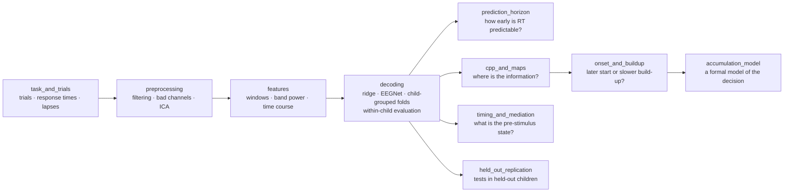

# CerebraLex

**When a child responds slowly, is it the brain's state before the stimulus, or the decision that unfolds after it?**

[](https://www.python.org/)
[](https://creativecommons.org/licenses/by-sa/4.0/)


This repository holds the analysis code for the paper *Neural Signals of Children’s Slow Responses Emerge During Decision Formation and Replicate in Held-Out Children* (Ahmadi, manuscript under
review).

Children's response times swing widely from one trial to the next, and this variability shrinks with age and marks
attention problems. Two accounts compete. Either a fluctuating brain state, present before the stimulus appears,
sets how fast the child will be; or the variability arises in the decision itself, as evidence about the stimulus is
accumulated. We decoded each trial's response time from the EEG, in windows placed before the stimulus and in windows
that open at the stimulus and close before the response, and asked which carries the information.

## At a glance

| | |
|---|---|
| **Participants** | 2,129 children and adolescents, 5 to 21 years |
| **Samples** | 1,728 in a discovery sample (Healthy Brain Network), 83 in an external cohort (MIPDB), 318 in a held-out sample (Healthy Brain Network releases R10 and R11) analysed only after the replication tests had been specified |
| **Task** | contrast change detection with 129-channel EEG |
| **Evaluation** | every prediction scored within child, so that it measures which of a child's trials are slow rather than which children are slow |
| **Replication** | 22 tests in the held-out sample, 14 supported |
| **Design** | not pre-registered; analyses added after related results had been seen are labelled post hoc in the paper |

## What we found

* **The decision, not the prior state, carries the response time.** Decoders of windows that start at the target and
  end before the response grow more accurate as the decision unfolds, and they overtake the pre-stimulus state near
  0.9 s in every sample. By 1.3 s they separate each child's slowest and fastest fifths of trials by 106 ms, against
  29 ms for the pre-stimulus state.
* **One centro-parietal signal.** The information lies in a single centro-parietal component that resembles the
  centro-parietal positivity (CPP), a neural signature of evidence accumulation.
* **Slow trials start later.** In every sample, slow trials began accumulating evidence later; a slower build-up did
  not replicate.
* **The pre-stimulus state is small but real.** It carries a modest signal, partly task timing, that is independent
  of the decision and predicts lapses.
* **Groups, not individuals.** Behaviour matures steeply with age, but trial-level couplings between EEG and behaviour
  are too unreliable to index individual differences.

## How the analysis fits together



## Repository map

The code is organised by the methods of the paper. Each folder holds the code of one method and its parameters
(`.yaml`), and every analysis script explains its inputs, outputs and options in its header.

| Method | Folder | Start with |
|---|---|---|
| Participants, task and trials | [`task_and_trials/`](task_and_trials) | `trials.py` (trial table, RT, lapses), `events.py` |
| EEG preprocessing and quality control | [`preprocessing/`](preprocessing) | `steps.py` (filters, bad channels, ICA), `preprocessing.yaml` |
| Analysis windows and features | [`features/`](features) | `windows.py`, `spectral.py`, `trial_measures.py` (CPP, alpha, SSVEP) |
| Decoders and within-child evaluation | [`decoding/`](decoding) | `benchmark.py`, `baselines.py`, `decomposition.py` (within- and between-child parts) |
| Sensitivity analyses | [`sensitivity_analyses/`](sensitivity_analyses) | `sensitivity_analyses.py`, `sensitivity.yaml` |
| Foundation-model comparison | [`foundation_model/`](foundation_model) | `reve_unseen_children.py` |
| Prediction horizon | [`prediction_horizon/`](prediction_horizon) | `prediction_horizon.py` |
| Maps, CPP and single-trial measures | [`cpp_and_maps/`](cpp_and_maps) | `rt_information_maps.py`, `single_trial_associations.py` |
| Onset, build-up rate and calibration | [`onset_and_buildup/`](onset_and_buildup) | `cpp_onset_rate.py`, `cpp_onset_rate_calibration.py` |
| Task timing, mediation and forward patterns | [`timing_and_mediation/`](timing_and_mediation) | `timing_mediation_patterns.py` |
| Accumulation model | [`accumulation_model/`](accumulation_model) | `accumulation.py` (model), `accumulation_model_fit.py` |
| Effect sizes, ceiling, lapses and reliability | [`effect_sizes/`](effect_sizes) | `effect_sizes.py` |
| Development and psychopathology | [`development_and_psychopathology/`](development_and_psychopathology) | `cpp_coupling_by_age.py` |
| State models and trait moderation (H2) | [`state_models_and_trait_moderation/`](state_models_and_trait_moderation) | `trait_state_moderation.py`, `trait_state.py` |
| Symbol Search | [`symbol_search/`](symbol_search) | `symbol_search.py` |
| Held-out replication | [`held_out_replication/`](held_out_replication) | `replication_tests.py` |
| Shared code | [`common/`](common) | configuration, paths, input and output |

## Built-in safeguards

* **Within-child scoring.** Pooled accuracy rewards knowing which children are slow; every decoder is also scored on
  the variation inside each child (`decoding/decomposition.py`).
* **Child-grouped cross-validation.** A child's trials never appear in both training and test folds; one release (R5)
  is held out entirely (`decoding/splits.py`, `decoding/leakage.py`).
* **Everything fitted inside the fold.** Standardisation, dimensionality reduction and penalty selection are fitted
  on training children only (`decoding/baselines.py`).
* **Parameters in one place.** Preprocessing, windows, decoders and the sensitivity analyses read their settings from the
  `.yaml` files next to their code.
* **Held-out replication.** Each replication test ran once, on children whose data had not been analysed
  (`held_out_replication/`).

## Data

The repository contains no data, results or trained models. The analyses use:

* **HBN-EEG** (Shirazi et al., 2024): releases R1 to R11 and NC, contrast change detection and Symbol Search tasks,
  with the participant tables. Available on OpenNeuro under CC BY-SA 4.0 (the NC release under CC BY-NC-SA 4.0).
* **MIPDB** (Langer et al., 2017), from the FCP-INDI distribution.
* **REVE-base** (El Ouahidi et al., 2025): embeddings from the released model at the revision pinned in
  `foundation_model/reve.yaml`, used under the REVE Responsible Use License.

## Running the code

The code needs Python 3.12 and the packages in `requirements.txt`:

```bash
pip install -r requirements.txt
python -m decoding.benchmark_summary --help      # scripts run as modules, from the repository root
```

The locations of the derivative data are set in `common/derivatives.yaml` and `common/paths.py`, and each can be
moved with an environment variable. Random seeds in this copy are set to a single neutral value, so resampling-based
intervals can differ from the published ones in the last digit.

## Citation

If you use this code, please cite the paper:

> Ahmadi, A.; Ghorbani Lohesara, F. (2026). *Neural Signals of Children’s Slow Responses Emerge During Decision Formation and Replicate in Held-Out Children*. Manuscript under review.

```bibtex
@unpublished{ahmadi_children_slow_responses,
  author = {Ahmadi, Amirmasoud; Ghorbani Lohesara, Fatemeh},
  title  = {Neural Signals of Children’s Slow Responses Emerge During Decision Formation and Replicate in Held-Out Children},
  note   = {Manuscript under review},
  year   = {2026}
}
```

## Acknowledgements

We thank the families who took part in the Healthy Brain Network and in the Multimodal Resource for Studying
Information Processing in the Developing Brain, the Child Mind Institute for sharing the data, and the authors of
REVE for releasing their model.

## Licence

CC BY-SA 4.0 (see [`LICENSE`](LICENSE)), matching the licence of HBN-EEG.

---

Amirmasoud Ahmadi · Max Planck Institute for Biological Intelligence, Seewiesen · questions are welcome as issues
